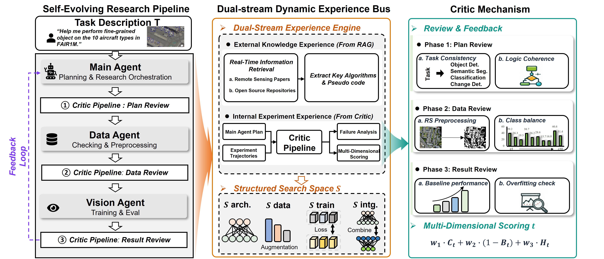
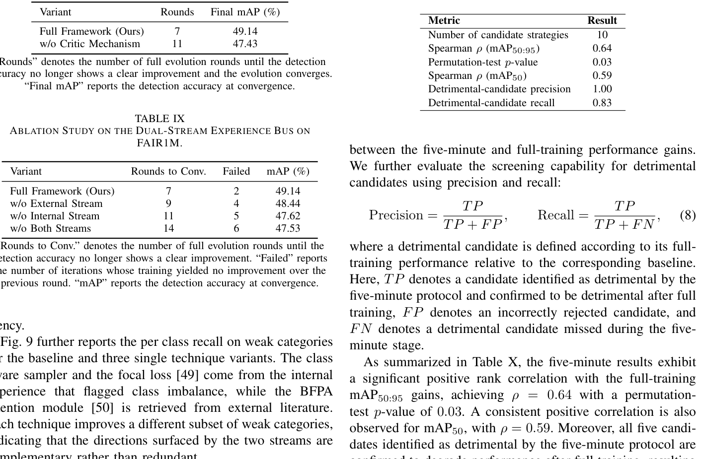
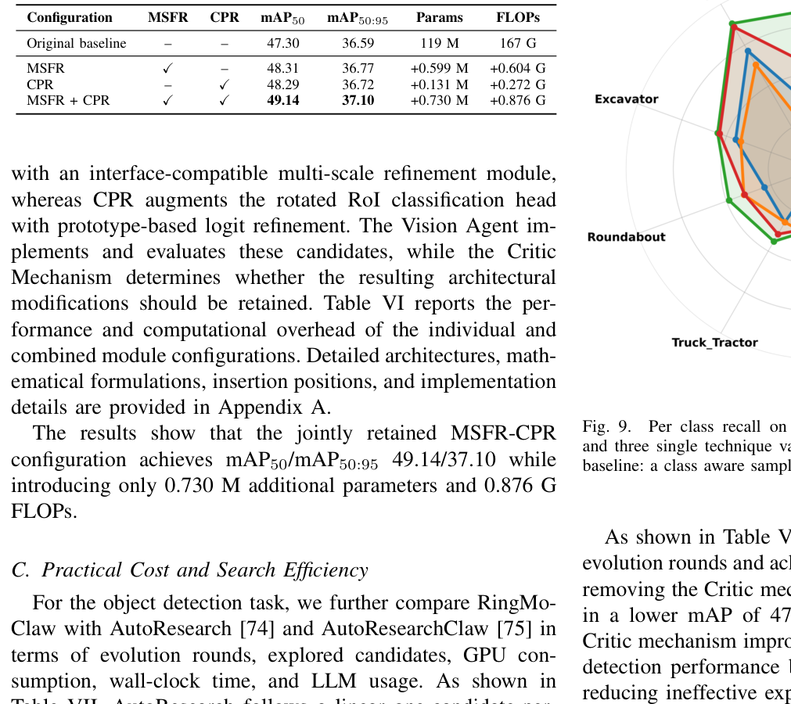
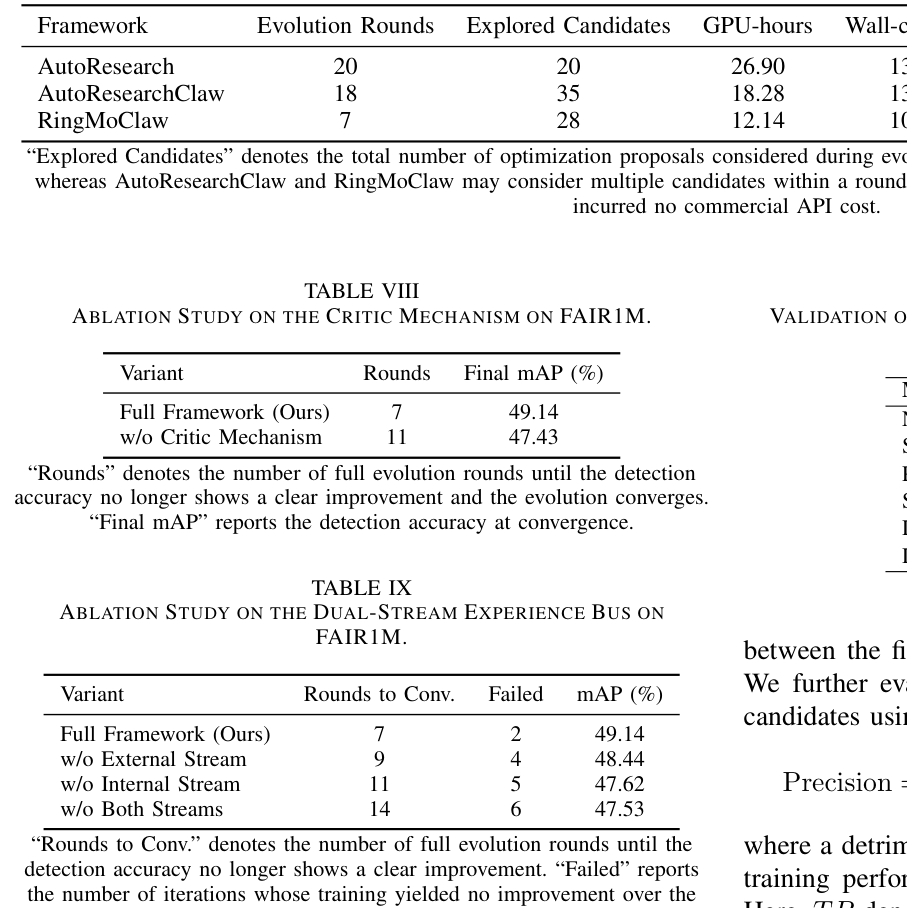
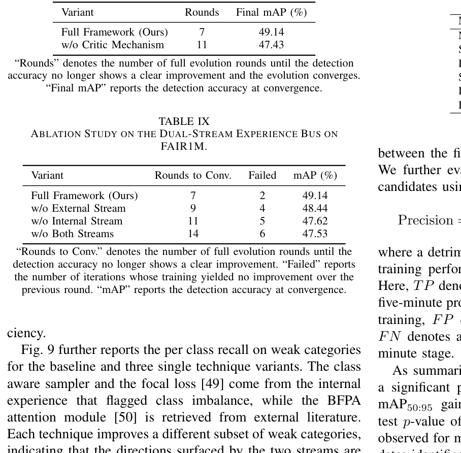
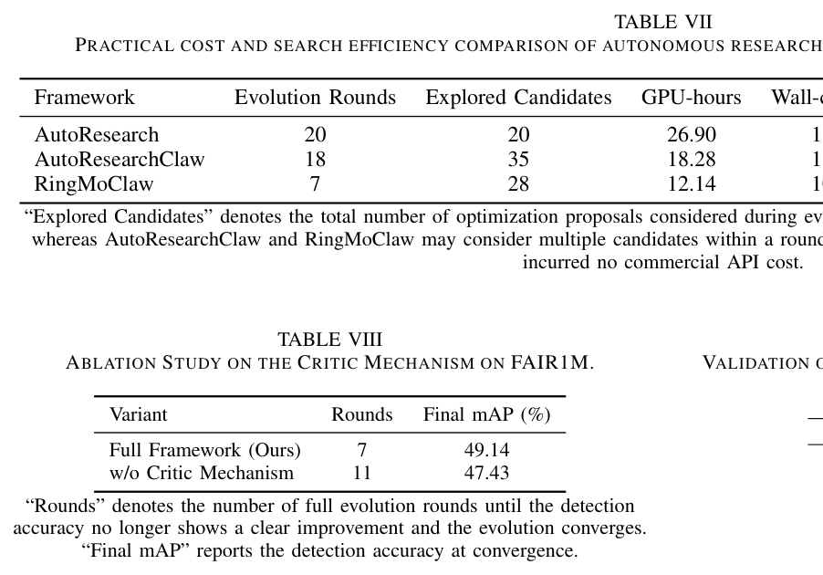

# RingMoClaw：经验驱动的遥感自主演化多智能体科研框架
**超越单次工作流编排，构建'假设-实验-异构审稿-双流经验'的遥感模型连续进化闭环**

Kaiyue Kang、Qixuan He、Peijin Wang、Yingchao Feng、Chao Ren、Kangxin Wang、Wenhui Diao、Yixiao Wang、Liangjin Zhao、Kaiwen Wei、Nayu Liu、Xian Sun · arXiv:2609.00814v2 (preprint · venue unverified) · 2026

> 遥感视觉基础模型的研究长期依赖领域专家的直觉试错与手工调参。现有多智能体多停留在'根据指令调用工具'的单次编排层面，缺乏针对复杂长尾地物与小目标瓶颈进行自主科研迭代的能力。中科院空天信息创新研究院孙显研究员团队提出的 RingMoClaw，首次建立了具备异构审稿机制与双流动态经验总线的自演化科研闭环，使遥感模型优化探索步数减少 40% 以上，并成功实现微结构级别的自主网络设计。

---

## 目录
1. [范式跃迁：从一次性任务编排到自演化科研闭环](#sec-01)
2. [体系架构解耦：科研执行分支、异构审稿人与双流经验总线](#sec-02)
3. [经验认知与决策中枢：双流经验总线、多阶段 Critic 与敏捷验证协议](#sec-03)
4. [实证突破：目标检测七轮演化轨迹与 MSFR/CPR 架构自主发现](#sec-04)
5. [全域泛化与效率超越：四大遥感下游任务评测与对标 AutoResearch](#sec-05)
6. [深度消融与科学边界：审稿机制/经验总线消融与方法有效性边界](#sec-06)
7. [证据来源与页面锚点](#sources)

---

## 1. 范式跃迁：从一次性任务编排到自演化科研闭环 

> *遥感解译从工具自动化迈向自主模型进化的必然逻辑。*

近年来，以 RingMo、SpectralX 等为代表的遥感基础大模型极大推动了对地观测领域的智能化水平。然而，在面对具体下游场景时，模型的持续调优依然是一项极度消耗人力的手工业：针对高分辨率影像中的密集小目标漏检、复杂地物长尾分布、以及跨区域传感器谱段漂移，算法研究员需要耗费大量时间进行特征重加权、数据增广方案比选、损失函数微调和错误切片归因。 〔p.1, p.2〕

### 现有遥感智能体与 RingMoClaw 自演化范式对比：突破单次任务执行与孤立经验的局限，构建包含独立审稿与双流经验演化的闭环。

 〔F01, p.2〕

现有基于大模型的多智能体系统（如 GeoAgent、EarthAgent）主要聚焦于一次性任务求解与工具链组合：给定用户意图，Agent 能够规划出‘加载影像 -> 瓦片裁剪 -> 调用分割模型 -> 矢量化存储’的流水线。然而，这种单向执行机制缺乏科研迭代的核心灵魂——它无法在推断发现精度瓶颈后提出假设、无法设计对比实验验证假设、更无法从失败中提炼出可指导下一步搜索的系统经验。RingMoClaw 正是为了填补这一断层而诞生。 〔F01, p.2〕

## 2. 体系架构解耦：科研执行分支、异构审稿人与双流经验总线 

> *双模型物理隔离防御自评合谋，多智能体分工协同与闭环经验耦合。*

为了避免大模型自主科研中最为致命的‘自评自嗨’与‘局部伪优化’陷阱，RingMoClaw 在体系结构上做出了严格的物理分离与异构设计。如图 2 所示，整个系统划分为科研执行分支（左侧）、异构审稿分支（右侧）以及位于中央的双流动态经验总线（Experience Bus）。

### 图2：RingMoClaw 整体系统体系结构全景图。展示了 Main/Data/Vision Agent 执行分支、沙箱评测执行器、异构 Critic 审查卡点以及双流经验总线的闭环流转。

 〔F02, p.4〕

在科研执行分支中，多智能体各司其职：
1. **Main Agent（顶层规划与假设生成）：** 负责根据当前任务目标、历史探索轨迹以及经验总线检索到的先验算子，提出明确的技术改进假设，并生成结构化的整体研究方案。
2. **Data Agent（数据工程智能体）：** 针对遥感高分辨率遥感切片重叠度、正负样本极度失衡及长尾类别分布，负责数据采样策略、几何与光度数据增广方案的编写与测试。
3. **Vision Agent（模型与训练实操智能体）：** 负责神经网络架构代码编写、损失函数与优化器超参配置、训练脚本实操与梯度反传监控。
4. **Experiment Executor（沙箱化实验执行器）：** 在受控的软硬件沙箱中执行自动化训练与评测，提取显存、日志、收敛曲线与量化评测指标。

与执行分支并行且相互制约的是异构质量控制分支（Critic Mechanism）。执行分支由 GLM-5 Turbo 驱动，而 Critic 则由独立的 Minimax 2.7 驱动。两类完全不同技术谱系的底层大模型有效化解了同一模型自我评估时的认知盲区与同质化偏差。Critic 在方案提出、数据准备与实验结果三大阶段设立严格质量卡点，所有未达标的尝试均被驳回并将其失败特征注入局部禁忌表与负向经验记忆中。 〔F02, p.4, p.5〕

## 3. 经验认知与决策中枢：双流经验总线、多阶段 Critic 与敏捷验证协议 

> *多维加权量化质检、算子空间类型约束与五分钟敏捷早筛机制。*

### Critic 异构质检机制的三阶段全链介入流图：方案审查、数据审查与结果审查协同运作，所有反馈均规范化路由至全局经验库。

 〔F04, p.7〕

Critic 绝不参与技术方案的生成与代码编写，只充当挑剔的‘独立审稿人’，并在三个关键阶段设立关卡：
1. **方案审查（Plan Review）：** 评估方案的技术合理性与物理可解释性，拦截先验冲突与超参荒谬的配置；
2. **数据审查（Data Review）：** 严格检查切片有效性、标签泄漏风险与长尾负采样比例；
3. **结果审查（Result Review）：** 定量诊断收敛稳定性、验证集瓶颈类别与潜在过拟合风险。

Critic 的决策通过多维加权综合评分公式精确量化：
$$Score_t = w_1 \cdot C_t + w_2 \cdot (1 - B_t) + w_3 \cdot H_t$$
其中 $C_t$ 代表方案正确性与技术合理性得分，$B_t$ 代表当前遗留性能瓶颈的影响程度（Bottleneck Index），$H_t$ 代表与历史成功/失败经验的一致性评分，$w_1, w_2, w_3$ 为阶段依赖的归一化权重向量。系统设立了严格的放行门槛：仅当综合评分 $Score_t \ge 0.75$ 且瓶颈指数 $B_t \le 0.30$ 时方可裁定为放行（Accept）；若 $Score_t \in [0.55, 0.75)$ 则打回修改（Revise）；若低于阈值则彻底驳回（Reject）；若发生极端不确定性则上报升级（Escalate）。所有审查反馈均结构化写入经验库。 〔F04, p.6, p.7〕

### 双流动态经验总线架构：外部文献与开源代码算子流结合内部任务内/跨任务记忆，支撑有向剪枝与敏捷验证驱动的自演化。

 〔F05, p.8〕

为解决开放代码生成容易产生语法正确但语义荒谬导致训练崩溃的问题，RingMoClaw 创新设计了双流动态经验总线：
- **外部经验流：** 通过 RAG 从前沿论文抽取高层机理，从 GitHub 开源代码剥离出纯净的前向张量算子，形式化定义为类型签名 $\omega = \{I, O, F, P\}$（输入张量、输出张量、变换函数、可调参数），在架构、训练、数据、集成四大维度上动态扩充结构化搜索空间 $S$（内置 23 个基础算子）。
- **内部经验流：** 维护任务内局部禁忌表（避免重复踏入刚踩过的坑）与跨任务全局经验库。当智能体面对新任务时，可基于任务语义相似度检索最匹配的先验策略，实现跨任务经验迁移。 〔F05, p.7, p.8〕

为了在极低算力约束下评估候选策略的有效性，团队建立了五分钟敏捷验证协议（Agile Verification Protocol）。每个候选策略在 2 张 RTX 4090 上仅微缩训练 5 分钟，通过早期性能增益与损失方差稳定性计算综合适应度评分 f_score（$f_{score}$）。仅当综合适应度评分 f_score > 0.55 且通过 Critic 审查时方能晋级进入全量训练。

### 表X：五分钟敏捷验证协议的统计可靠性与早筛精度验证结果。

 〔T10, p.14〕

如表X 所示，五分钟敏捷早筛结果与最终全量训练排名的 Spearman 秩相关系数达到 0.64 ($p=0.03$)。在对有害候选策略的拦截能力上，该协议对劣化候选策略的早筛精确率达到了 1.00（即所有被敏捷协议判定为劣化的候选策略经全量验证均为真实劣化，实现了零误拦截）；对劣化候选策略的召回率为 0.83（全量训练发现的 6 个真实劣化候选中有 5 个被成功早筛拦截，仅 1 个劣化策略漏过早筛），在可控开销下实现了高置信度筛选。 〔T10, p.8, p.14〕

## 4. 实证突破：目标检测七轮演化轨迹与 MSFR/CPR 架构自主创新 

> *长尾高分辨率遥感旋转目标检测：从数据空间重采样到网络微结构自主发明。*

### 表I：FAIR1M 旋转目标检测逐轮演化结果（%）：总体 mAP50 稳步提升，长尾弱势类别实现跨越式突破。

 〔T01, p.9〕

在 FAIR1M-v1.0 高分辨率遥感旋转目标检测基准上，RingMoClaw 展现了清晰的科研演化轨迹。基线采用 YOLO11x-OBB 旋转检测头，初始取得了 47.30% 的 mAP50。
> **注：** FAIR1M 实验全流程独立重复进行了 3 次，表I 完整呈现的是 3 次独立演化试验中的最优轨迹。

- **阶段 1（数据工程演化）：** Data Agent 针对高频与罕见类别（如各类特种飞机、挖掘机）自适应调整切片重叠与几何色彩增广，mAP50 提升至 48.18%。
- **阶段 2（失败试错与否定）：** 智能体尝试少样本重采样微调发现精度不升反降，Critic 敏锐定位出一阶段检测头召回不足的瓶颈，果断否定该路线并记录至负向记忆中。
- **阶段 3（微结构自主创新）：** 在常规调参空间饱和后，Main Agent 提出了两大网络微结构假设：多尺度特征细化模块（MSFR）与对比原型细化分类头（CPR）。

### 表VI：MSFR 与 CPR 模块独立与联合消融评估结果（%）：微量参数换取显著性能增益。

 〔T06, p.13〕

两大微结构创新模块（MSFR 与 CPR）的张量流转与算子级机理如下：

1. **多尺度特征细化模块（MSFR，附录 A.1 细节）：**
   - **痛点根源：** 遥感俯视视角下密集小目标（如小型车辆、集装箱）尺度极小（常常仅占数十像素），在骨干网络自底向上深层抽象中极易在步长下采样与高层语义压缩中损失局部高频纹理与精细几何边缘。
   - **张量流动与算子拆解：**
     - **跨层级特征对齐（Cross-Level Feature Alignment）：** 取 FPN 金字塔邻近层特征图 $F_l \in \mathbb{R}^{C \times H_l \times W_l}$ 与 $F_{l+1} \in \mathbb{R}^{C \times \frac{H_l}{2} \times \frac{W_l}{2}}$，利用双线性插值或步长转置卷积将高层语义图上采样至相同空间分辨率后在通道维度级联。
     - **空间与通道注意力细化（SE/CBAM Hybrid Attention）：** 级联特征经过一组轻量级 $3 \times 3$ 深度可分离卷积提取局部空间模式，随后分别沿通道维度进行全局平均池化与最大池化，生成多尺度细化残差张量 $\Delta F_l$。
     - **零初始化门控残差注入（Zero-Initialized Gated Residual Injection）：** 细化残差通过自适应门控缩放因子注入原始主干特征图：
       $$F'_l = F_l + \gamma_l \cdot \Delta F_l$$
       其中缩放标量 $\gamma_l$ 严格初始化为 0。这一设计是保证自演化搜索平稳收敛的核心枢纽：在智能体探索早期向复杂预训练骨干动态插入 MSFR 结构时，由于 $\gamma_l = 0$，网络前向传播完全保持恒等映射（Identity Mapping），彻底避免了随机初始化权重对已有特征表征的破坏性冲击；随着后续训练迭代，$\gamma_l$ 自适应学习非零增益，平滑引入多尺度细化残差。
   - **实证增益：** 单独引入 MSFR 仅增加微量算力开销，在表VI 评估中取得 0.88 个百分点的 mAP 提升。

2. **对比原型细化分类头（CPR，附录 A.2 细节）：**
   - **痛点根源：** 遥感长尾地物存在极强的高类间混淆（例如“大型货车”与“拖车”、“民航客机”与“军用运输机”），传统线性分类头 $W \cdot z_i + b$ 在高维特征边界处的线性决策超平面极易受类内方差与长尾类别样本稀疏影响而产生错误偏移。
   - **张量流动与算子拆解：**
     - **RoI 特征与原型矩阵映射：** 对于经过 RoI Align 提取的区域紧凑特征向量 $z_i \in \mathbb{R}^D$（维度 $D=256$），CPR 在分类头中显式维护可学习的类别原型矩阵 $P \in \mathbb{R}^{K \times D}$（$K$ 为目标类别数），各原型向量表示该类别在特征流形上的几何聚类中心。
     - **多样本对比损失校准（Contrastive Regularization）：** 在训练阶段，利用 InfoNCE 形式的监督对比损失拉近同类样本与对应原型的余弦相似度，推远负类原型：
       $$\mathcal{L}_{cpr} = - \log \frac{\exp(\text{sim}(z_i, P_{y_i}) / \tau)}{\sum_{j=1}^K \exp(\text{sim}(z_i, P_j) / \tau)}$$
       其中 $\tau$ 为温度超参数。这一对比约束迫使特征空间中同一类别的高阶特征向原型紧密聚集，大幅压缩类内方差并拉开易混淆类别间的角距离。
     - **分类 Logits 融合（Logits Calibration）：** 最终前景色分类预测综合线性前向输出与原型相似度软匹配：
       $$\hat{y}_i = \text{Softmax}\left( W z_i + \lambda \cdot \text{sim}(z_i, P) \right)$$
       借由原型余弦距离对边界模糊的困难候选框 logits 实施显式校准。
   - **实证增益：** 单独引入 CPR 使检测精度提升 0.94 个百分点，显著改善了旋转长尾目标的分类召回率。

3. **联合增益与资源开销：** 两项模块联合使用时，以仅增加 0.73M 参数量（+1.1%）和 0.88G FLOPs 的极轻微代价，将检测精度从 47.30% 推升至 49.14%（净提升 1.84 个百分点），展现出良好的增量累加效果，证实了自演化系统在无人工干预下具备发现落地级网络微结构并平衡计算效率的科研能力。 〔T06, p.13〕

## 5. 全域泛化与效率超越：四大遥感下游任务评测与对标 AutoResearch 

> *跨任务泛化验证与端到端计算资源开销大幅度压缩。*

为验证框架的普适性，作者进一步在 NWPU-RESISC45 场景分类、iSAID 语义分割与 LEVIR-CD 变化检测上进行了评测：
- **场景分类：** 演化出互补特征模型的 Soft-TTA 融合策略，准确率从 93.18% 提升至 94.97%；
- **语义分割：** 演化出多尺度上采样 TTA 结构，mIoU 从 67.2% 攀升至 69.9%；
- **变化检测：** 演化出 EvoChangeStar 双向时序交互网络，F1 达到 90.54%，IoU 从 87.10% 提升至 89.97%（注：论文未公开具体评测脚本，数值偏离单类别二值公式属于基准约定未决项 UNRESOLVED，可能源于类别平均或多分类评估定义）。 〔T02, T03, T04, p.11, p.12〕

### 表VII：RingMoClaw 与 AutoResearch 在各任务上的算力消耗与搜索效率综合对比。

 〔T07, p.14〕

如表VII 所示，与自动化科研基线 AutoResearch 相比，AutoResearch 依赖单智能体无向试错，在复杂检测任务中易陷入局部负收益（-3.50%）；而 RingMoClaw 依托经验剪枝与审稿把关，在所有 4 项任务中均仅需 4~7 轮即可收敛至最优。在硬件开销方面，总 GPU 算力消耗时间（GPU-hours）从 AutoResearch 的 26.90 小时压减至 12.14 小时，端到端实际挂钟时间（wall-clock hours）从 13.45 小时缩减至 10.61 小时，不仅大幅降低了科研资源门槛，更证实了经验指导探索的高效性。 〔T07, p.14〕

## 6. 深度消融与科学边界：审稿机制/经验总线消融与方法有效性边界 

> *定量解构异构审稿与经验总线的独立贡献，明确方法适用边界与未解挑战。*

### 表VIII：FAIR1M 数据集上 Critic 审稿机制各组件的逐步消融实验结果。

 〔T08, p.14〕

### 表IX：FAIR1M 数据集上双流经验总线各模块的消融实验结果。

 〔T09, p.14〕

严谨的消融实验定量厘清了系统内部的功劳归属：
1. **Critic 审稿机制的独立价值（表VIII）：** 移除 Critic 机制后，演化收敛轮数从 7 轮激增至 11 轮，且由于缺乏各阶段质量把关，最终 mAP 下降至 47.43%（损失 1.71 个百分点）；若仅保留同质模型审稿，收敛步数同样增加且容易陷入局部次优。
2. **双流经验总线的独立价值（表IX）：** 移除外部经验流导致智能体无法引入前沿算子，精度停留在 47.96%；若完全剥离双流经验总线，系统退化为盲目随机试错，需要 14 轮且经历了 6 次非提升探索迭代（failed iterations，指未能带来验证集精度增益的候选搜索尝试，而非训练程序崩溃）。

作为理性科研系统，作者亦坦诚剖析了当前方案的方法边界与局限：
1. **敏捷验证的漏检代价：** 表X 显示，虽然五分钟敏捷早筛将劣化方案的识别精确率做到了 1.00，但召回率为 0.83，意味着有 1 个真实劣化策略漏过早筛而进入了全量训练阶段，在极端高成本大模型预训练中仍需权衡此开销；
2. **基线比较上下文：** 旋转检测中 YOLO11x-OBB 基线与微结构消融涉及不同的检测头与主干配置，不可直接外推至任意未测架构；
3. **范式边界：** 当前框架强依赖于数据驱动的模式识别与结构化算子空间；如何将更长程的演化机理与更广泛的多模态大模型深度融合，仍是未来科研智能体演进的重要方向。 〔T08, T09, T10, p.14, p.15〕

## 证据来源与页面锚点 

需要逐项核对来源时，请打开 [来源与核验记录](evidence_atlas.html)。
