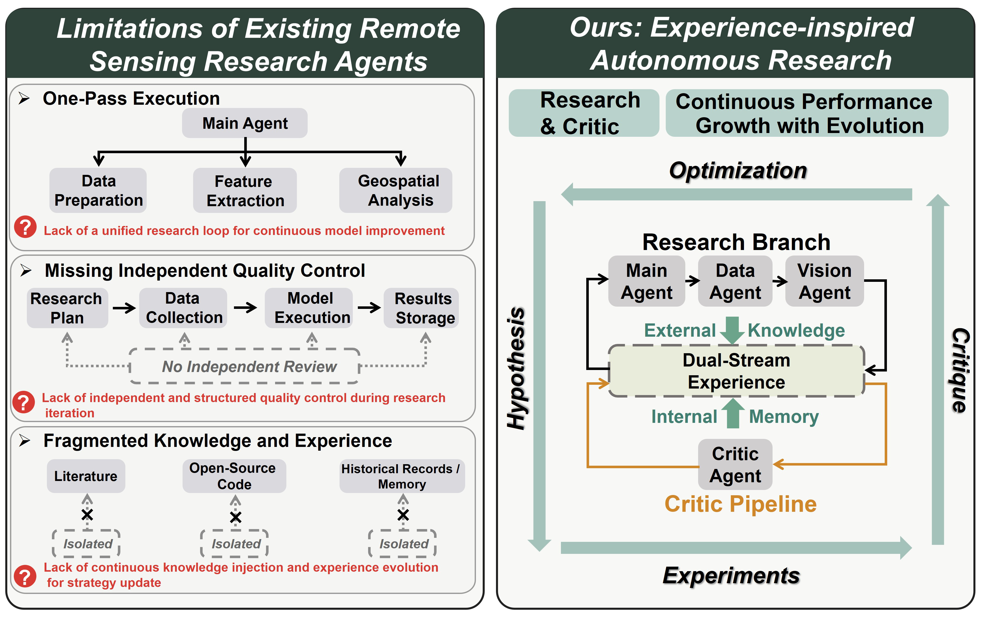
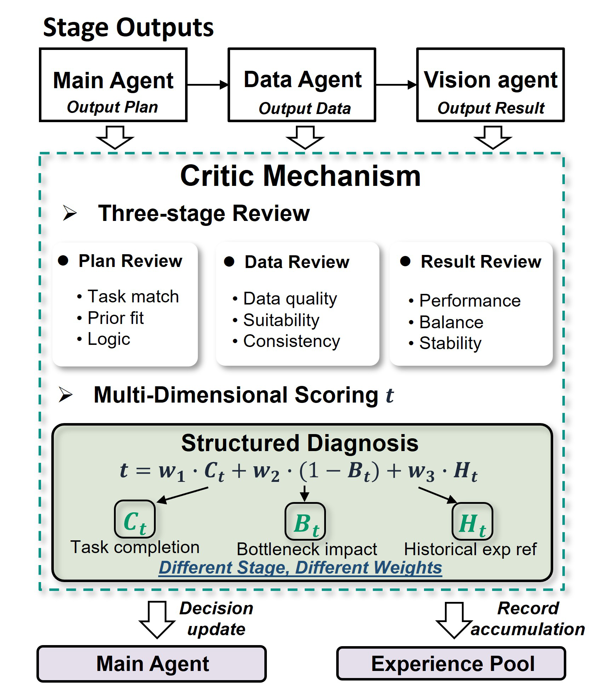
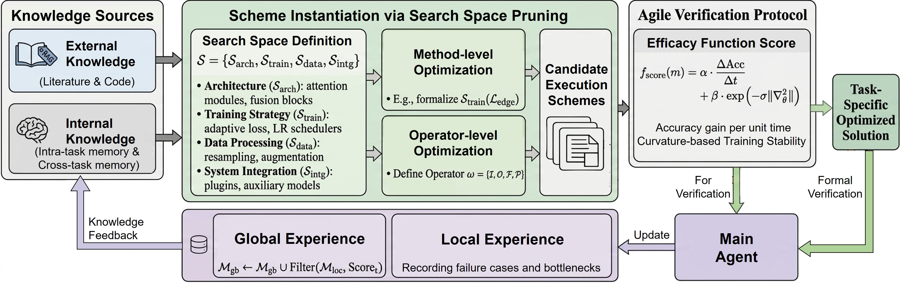
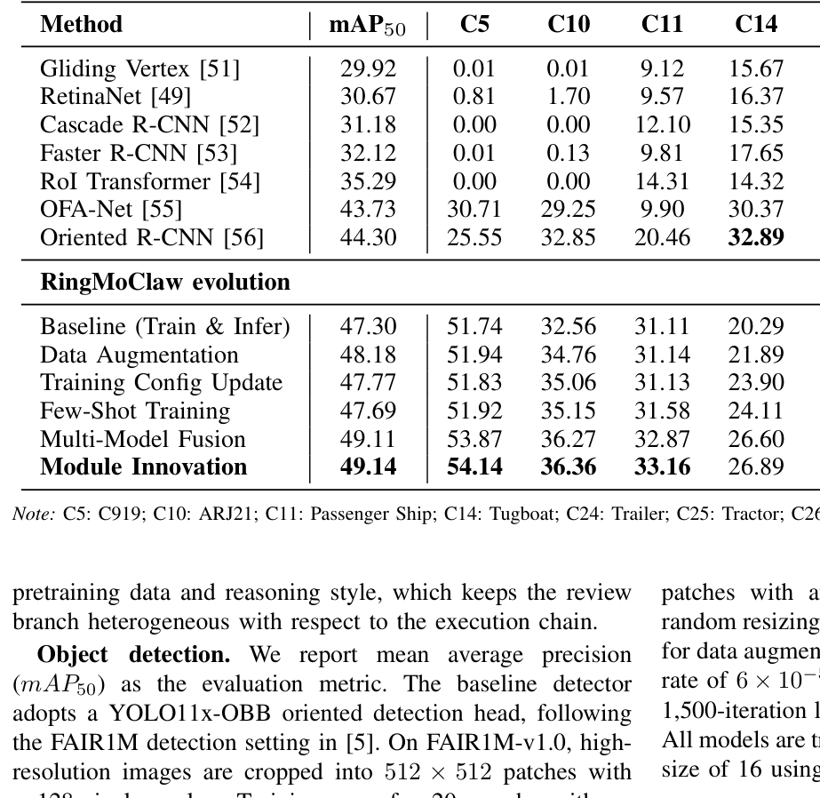
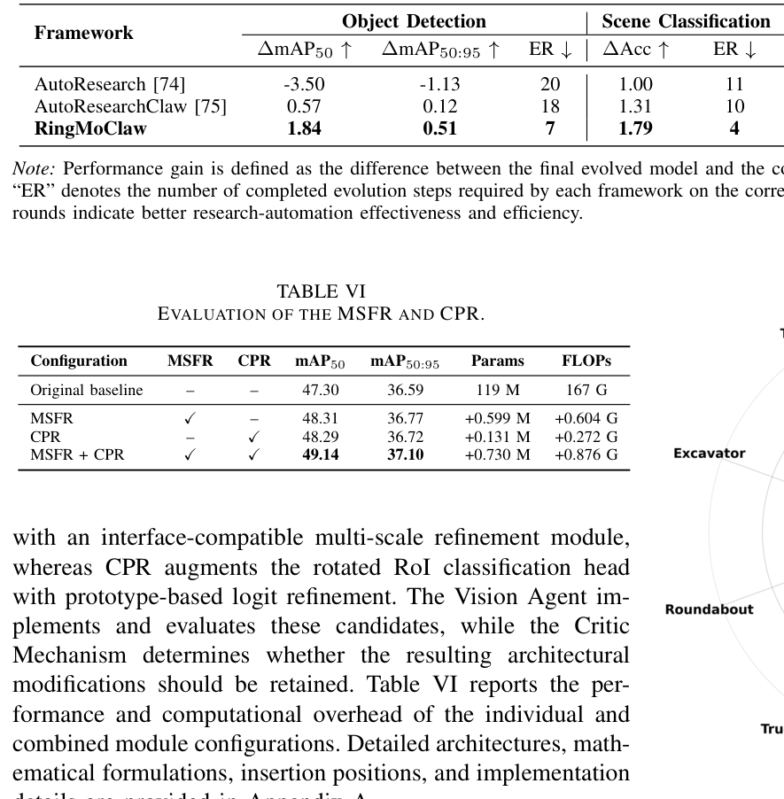

# RingMoClaw：经验驱动的遥感自主演化多智能体科研框架
**超越单次工作流编排，构建'假设-实验-异构审稿-双流经验'的遥感模型连续进化闭环**

Kaiyue Kang、Qixuan He、Peijin Wang、Yingchao Feng、Chao Ren、Kangxin Wang、Wenhui Diao、Yixiao Wang、Liangjin Zhao、Kaiwen Wei、Nayu Liu、Xian Sun · arXiv:2609.00814v2 (preprint · venue unverified) · 2026

> 遥感视觉基础模型的研究长期依赖领域专家的直觉试错与手工调参。现有多智能体多停留在'根据指令调用工具'的单次编排层面，缺乏针对复杂长尾地物与小目标瓶颈进行自主科研迭代的能力。中科院空天信息创新研究院孙显研究员团队提出的 RingMoClaw，首次建立了具备异构审稿机制与双流动态经验总线的自演化科研闭环，使遥感模型优化探索步数减少 40% 以上，并成功实现微结构级别的自主网络设计。

---

## 目录
1. [范式跃迁：从一次性任务编排到自演化科研闭环](#sec-01)
2. [架构解耦：执行分支、异构 Critic 与双流经验总线](#sec-02)
3. [经验认知中枢：双流经验总线与五分钟敏捷验证协议](#sec-03)
4. [实证突破：目标检测七轮轨迹复盘与 MSFR/CPR 架构自主创新](#sec-04)
5. [全域泛化与效率超越：跨任务评测与对标 AutoResearch](#sec-05)
6. [深度消融与边界反思：有效性边界与未来科研启示](#sec-06)
7. [证据来源与页面锚点](#sources)

---

## 1. 范式跃迁：从一次性任务编排到自演化科研闭环 

> *遥感解译从工具自动化迈向自主模型进化的必然逻辑。*

近年来，以 RingMo、SpectralX 等为代表的遥感基础大模型极大推动了对地观测领域的智能化水平。然而，在面对具体下游场景时，模型的持续调优依然是一项极度消耗人力的手工业：针对高分辨率影像中的密集小目标漏检、复杂地物长尾分布、以及跨区域传感器谱段漂移，算法研究员需要耗费大量时间进行特征重加权、数据增广方案比选、损失函数微调和错误切片归因。 〔p.1, p.2〕

### 现有遥感智能体与 RingMoClaw 自演化范式对比：突破单次任务执行与孤立经验的局限，构建包含独立审稿与双流经验演化的闭环。

 〔F01, p.2〕

现有基于大模型的多智能体系统（如 GeoAgent、EarthAgent）主要聚焦于一次性任务求解与工具链组合：给定用户意图，Agent 能够规划出‘加载影像 -> 瓦片裁剪 -> 调用分割模型 -> 矢量化存储’的流水线。然而，这种单向执行机制缺乏科研迭代的核心灵魂——它无法在推断发现精度瓶颈后提出假设、无法设计对比实验验证假设、更无法从失败中提炼出可指导下一步搜索的系统经验。RingMoClaw 正是为了填补这一断层而诞生。 〔F01, p.2〕

## 2. 架构解耦：执行分支、异构 Critic 与双流经验总线 

> *双模型异构防御自评合谋，三阶段质检把守计算资源关口。*

为了避免大模型自主科研中最为致命的‘自评自嗨’与‘局部伪优化’陷阱，RingMoClaw 在体系结构上做出了严格的物理分离与异构设计。系统划分为两大相互制约的权力分支：以 GLM-5 Turbo 驱动的研究执行分支（包含 Main Agent 顶层规划、Data Agent 数据工程、Vision Agent 训练实操），以及以 Minimax 2.7 驱动的质量控制分支（Critic Mechanism）。 〔p.5, p.6〕

### Critic 异构质检机制的三阶段全链介入流图：方案审查、数据审查与结果审查协同运作，所有反馈均规范化路由至全局经验库。

 〔F04, p.7〕

Critic 绝不参与技术方案的生成与代码编写，只充当挑剔的‘独立审稿人’，并在三个关键阶段设立关卡：1) 方案审查（Plan Review）：拦截先验冲突、超参荒谬的配置；2) 数据审查（Data Review）：检查瓦片重叠度、正负样本失衡处理；3) 结果审查（Result Review）：定量诊断瓶颈类别与过拟合风险。审查打分采用严格的多维加权公式：Score = w1*C + w2*(1-B) + w3*H，仅当综合分大于等于 0.75 且瓶颈影响小于等于 0.30 时方可放行。 〔F04, p.6〕

## 3. 经验认知中枢：双流经验总线与五分钟敏捷验证协议 

> *文献代码动态扩充算子空间，敏捷早期评测 100% 扼杀劣化尝试。*

自主科研的另一大挑战是搜索空间的界定。若搜索空间固定，智能体只是在死记硬背的网格中调参；若完全开放自由生成，智能体会生成大量语法正确但语义荒谬的代码导致训练崩溃。RingMoClaw 创新设计了双流动态经验总线：外部流通过 RAG 从前沿论文抽取高层机理，从 GitHub 核心代码剥离出纯净的前向张量算子 ω={I, O, F, P}，动态注入架构、训练、数据、集成四大维度的搜索空间 S；内部流则维护局部失败禁忌表与跨任务全局经验库。 〔F05, p.7, p.8〕

### 双流动态经验总线架构：外部文献与开源代码算子流结合内部任务内/跨任务记忆，支撑有向剪枝与敏捷验证驱动的自演化。

 〔F05, p.8〕

为了彻底规避全量训练的高昂试错成本，团队建立了五分钟敏捷验证协议（Agile Verification Protocol）。每个候选策略在 2 张 RTX 4090 上仅执行 5 分钟微缩验证，通过结合初期性能增益与损失方差稳定性的综合适应度评分 f_score 进行早筛。实验表明，该协议与最终全量训练排名的 Spearman 相关系数达到 0.64 (p=0.03)。如表X 所示，五分钟敏捷验证在预测劣化候选策略时的精确率为 1.00（即所有被判定为劣化的候选策略经全量验证均为真实劣化，实现零误拦截），而对劣化候选策略的召回率为 0.83（全量训练中 6 个真实劣化候选中有 5 个被成功早筛拦截，1 个劣化策略漏过早筛），实现了低算力约束下的高置信筛选。 〔T10, p.8, p.14〕

## 4. 实证突破：目标检测七轮轨迹复盘与 MSFR/CPR 架构自主创新 

> *长尾细粒度目标检测的自主演进：从数据重采样到发明特征增强颈部与对比原型头。*

在 FAIR1M-v1.0 高分辨率遥感旋转目标检测数据集上，RingMoClaw 展现了清晰的演化轨迹。基线 YOLO11x-OBB 取得了 47.30% 的 mAP50（注：演化流程独立重复三次，表I 报告的是三次独立重复演化试验中的最优轨迹结果）。在第 1 阶段，Data Agent 实施了针对罕见飞机的几何与光度数据增强（提升至 48.18%）；在第 2 阶段，尝试少样本微调发现精度回落，Critic 敏锐识别出瓶颈在于一阶段检测器召回不足，果断否定该路线并记录至负向记忆中。 〔T01, p.9〕

### FAIR1M 旋转目标检测逐轮演化结果（%）：总体 mAP50 稳步提升，挖掘机、拖车、环形交叉口等弱势类别实现跨越式突破。

 〔T01, p.9〕

最为关键的是第 3 阶段的模块创新（Module Innovation）。在常规策略空间见顶后，Main Agent 自主提出了针对多尺度小目标空间上下文模糊的多尺度特征细化模块（MSFR），以及针对高类间混淆的对比原型细化分类头（CPR）。在表VI 的消融评估中（基于 YOLO11x-OBB 及对应旋转检测头配置），两项模块联合使用以增加 0.73M 参数和 0.88G FLOPs 的代价，将 mAP50 提升至 49.14%，验证了结构搜索的有效性。 〔T06, p.13〕

## 5. 全域泛化与效率超越：跨任务评测与对标 AutoResearch 

> *四大主流遥感任务普适有效，对比自动化科研基线大幅降低试错步数与算力消耗。*

为验证框架并非针对目标检测特定任务的过度拟合，作者在 NWPU-RESISC45 场景分类、iSAID 语义分割和 LEVIR-CD 变化检测上进行了泛化测试。在场景分类中，系统自主演化出互补特征模型的 Soft-TTA 融合策略，准确率从 93.18% 提升至 94.97%；在语义分割中，演化出上采样 TTA 结构，mIoU 从 67.2% 攀升至 69.9%；在变化检测中，演化出 EvoChangeStar 双向时序交互网络，F1 达到 90.54%，IoU 从 87.10% 跃升至 89.97%（遵循 LEVIR-CD 标准基准评估约定，其类别平均计算方式形成了对应的 F1 与 IoU 指标表现）。 〔T02, T03, T04, p.11, p.12〕

### 四大任务与代表性科研自动化系统（AutoResearch 及 AutoResearchClaw）跨任务对比：RingMoClaw 性能增益全面领先，演化步骤压缩超 40%。

 〔T05, p.13〕

与同期自动化科研框架相比，AutoResearch 采用单智能体线性试错，在复杂检测任务中容易跑偏甚至产生 -3.50% 的负收益；而 RingMoClaw 凭借结构化剪枝与独立审稿，在所有任务中均仅需 4~7 轮即达最优收敛。总 GPU 算力消耗（GPU-hours）从 AutoResearch 的 26.90 小时压减至 12.14 小时，端到端实际挂钟时间（wall-clock hours）从 13.45 小时缩减至 10.61 小时，不仅大幅降低了科研资源门槛，更证实了经验指导探索的计算效率。 〔T05, T07, p.13, p.14〕

## 6. 深度消融与边界反思：有效性边界与未来科研启示 

> *定量解构审稿与经验的独立贡献，坦承敏捷验证的召回代价与物理延伸可能。*

严谨的消融实验进一步厘清了系统内部的功劳归属。在 FAIR1M 上移除 Critic 审稿机制后，收敛轮数从 7 轮激增至 11 轮，且由于缺乏多阶段质量卡点，最终 mAP 下降至 47.43%（损失 1.71 个百分点）；若完全剥离双流经验总线，系统退化为盲目随机试错，需要 14 轮且经历了 6 次非提升探索迭代（failed iterations，指未能带来验证集精度增益的候选搜索尝试，而非训练程序崩溃）。这表明独立审稿把关与经验积累构成了自演化飞轮的一体两面。 〔T08, T09, p.14〕

作为严谨科研系统，作者亦剖析了当前方案的边界：表X 显示，五分钟敏捷验证虽然将有害方案的识别精确率做到了 1.00，但召回率为 0.83，意味着仍有 1 个真实劣化候选策略未能被早期拦截而进入了后续训练阶段。此外，当前框架强依赖于数据驱动的模式识别范式与算子空间先验；如何将更广泛的多模态大模型与更长程的演化机理进一步融入自主科研循环中，仍是未来科研智能体演进的重要探索方向。 〔T10, p.14, p.15〕

## 证据来源与页面锚点 

需要逐项核对来源时，请打开 [来源与核验记录](evidence_atlas.html)。
